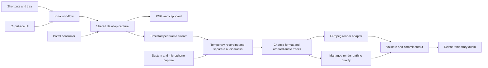

# Kino implementation plan

- Status: MVP implemented on Windows; proposals awaiting confirmation
- Owner: Wixely
- Created: 2026-11-24
- Last reviewed: 2026-11-25
- Review date: 2026-12-01, or when the open questions are answered
- Target date: None
- Repository: https://github.com/Wixely/Kino
- License: MIT, confirmed by the user

## Outcome

Kino is a desktop screenshot and screen-recording application that stays in the system tray and makes routine captures available through quick shortcuts. CupriFace supplies the interface. Shared capture components should serve both Kino and Portal, following Bantz's approach to reusable packages.

## Confirmed requirements

Source: User request, 2026-11-24.

- Name the application Kino and host it on GitHub under the MIT License.
- Capture screenshots and record the screen.
- Preserve Cliptrix's quick-shortcut idea.
- Use CupriFace and start in the system tray by default.
- Use a gold/amber theme with an amber-crystal snowflake icon, selected by the user on 2026-11-24. The README uses [the generated artwork](artwork/kino-amber-crystal.png).
- Use FFmpeg from the system PATH for video rendering, with the managed H.264 engine as a fallback or selectable alternative.
- Investigate Portal capture reuse and follow the standards of existing CupriFace desktop apps, including Bantz.

- Select the region before taking the screenshot or starting screen recording. Post-capture crop and video trim are later features, outside the MVP.
- Record system and microphone audio during video capture, then let the user choose what to include after recording. Finished videos contain no audio by default; Settings can change that default.
- Deliver Windows first, with Linux following later.
- Add quick image/video format conversion later. Video conversion should use FFmpeg commands.
- Video mode uses keys 2, 3 and 4, with 3 starting recording. Show a red frame around the recorded region, enabled by default and optionally disabled.
- Immediately after capture, choose audio inclusion, individual tracks and their order before rendering the final video. Support multiple audio tracks and delete temporary audio after successful rendering.
- Support MKV, MP4 and WebM output.
- Defer uploads beyond the MVP. Later, configure upload destinations through a bounded set of protocols, including HTTP POST with response parsing.

These scope clarifications were confirmed by the user on 2026-11-24. Backend fallback limits and some interaction details remain open.

## Evidence and dependencies

Evaluate shared capture contracts and implementations before creating a new backend. Reuse must have explicit buffer ownership, pixel formats, timestamps and platform capabilities. Verify the current implementation and publishing rights of any candidate before extraction.

Bantz supplies a package extraction pattern and candidate input/audio components. Its speech-oriented audio format should not become Kino's recording format by accident. System-audio loopback and synchronized stereo recording need separate evaluation.

## Proposed first release

### Quick capture

Use the user's Cliptrix workflow: Ctrl+Numpad1 marks the top-left corner at the current pointer location. The user keeps Control held, moves the mouse and presses Numpad2 to set the bottom-right corner. In image mode, that completes the region, captures its pixels and immediately copies the cropped image for pasting into chats. Selection precedes capture; there is no post-capture crop step.

A small preview window appears at the bottom-right of the screen between the two corner shortcuts. Keep the workflow free of full-screen selection overlays, mouse-button clicks and dragging. The user can move the pointer while preparing the next keypress, including across a large region. Keep the preview out of captured pixels. Proposed handling includes normalized corners for reverse-direction selection, mixed-DPI and negative monitor coordinates, and Escape to cancel without changing the clipboard.

Ctrl+Numpad3 saves the last image to a file and copies its path as text for sites that accept file uploads. A configurable destination avoids a save dialog on each capture. Proposed image format is PNG; screenshots must work without FFmpeg.

The user also described Ctrl+4/5/6 as direct-upload shortcuts that show a brief completion notification and copy the resulting URL. Uploads are deferred beyond the MVP; exact bindings and provider configuration belong to that later feature.

Allow configurable bindings, conflict reporting, restore defaults and a temporary shortcut-disable control. Keep an alternative for compact keyboards. Remembering the last region, window/monitor presets and optional drag-selection are secondary candidates; the two-corner workflow is the MVP priority.

### Screen recording

Video uses two-corner selection before recording begins, on its own keys (confirmed 2026-11-25): Ctrl+Numpad4 marks the first corner, Ctrl+Numpad5 marks the second corner and starts recording, and Ctrl+Numpad6 stops and asks whether to include audio. Choosing renders the video and copies its path. Screenshot and video keys no longer overlap, so no image/video mode is needed.

Show a red frame around the selected region while recording, enabled by default with an option to disable it. Keep the frame out of recorded pixels. A tray recording indicator and elapsed time remain available when the frame is disabled. The image workflow remains free of a full-screen selection overlay. Pause/resume, countdown, cursor inclusion and window/monitor presets remain proposed additions.

Capture system output and microphone audio throughout recording. After stopping, let the user choose silent output, system audio, microphone audio or both. Default to silent output, with the preferred inclusion choice configurable in Settings. Audio capture and audio inclusion are separate settings and states: silent export must not disable the required source recording.

Proposed implementation: retain temporary video and individual audio sources separately with a common timebase and a small recording manifest. Immediately after stopping, open a finishing screen to choose the output format, select audio tracks and arrange their order. No tracks are selected by default unless Settings changes that preference. Preserve selected sources as separate output tracks in the requested order; do not automatically mix them. Show unavailable/denied audio devices before starting and explain a device loss during recording. The working interpretation of “record all” is system output plus the selected microphone, not every connected input device.

Only begin the final H.264 or other chosen-format render after the user confirms the finishing choices. Capture-time storage is an internal staging format; its codec, disk budget and recovery scheme need a feasibility spike. Do not assume all raw frames can fit in memory or that temporary storage must be uncompressed.

Delete temporary audio once the rendered output has been validated and committed to its final file. Unselected audio is deleted too. Audio excluded from a finished video cannot be added later from discarded sources. On failed or cancelled renders, preserve the temporary recording for retry or explicit discard. Recovery after an application crash must distinguish unfinished renders from completed outputs awaiting cleanup.

MKV, MP4 and WebM are required output containers. Proposed FFmpeg presets are H.264/AAC for MP4 and MKV, and VP9/Opus for WebM, subject to capability checks and playback tests. H264Sharp is an H.264 backend, so a separate compatible encoding path is needed for WebM. Validate multi-track support and ordering for every offered preset; expose codec/container limitations before rendering instead of silently dropping tracks.

Use recoverable temporary recording storage and validate crash and power-loss behavior with the selected format. Show completion only after finalization succeeds. Preserve recoverable output and explain failures on disk exhaustion, encoder exit or target loss. Closing Settings must leave recording running; explicit Quit must handle an active recording visibly.

Start performance qualification at 1080p30. Treat 60 fps, 4K, HDR, webcam overlays, replay buffers, scrolling screenshots, OCR and a full video timeline as later candidates.

### Later features

Post-capture image/video cropping and video trimming are explicitly outside the MVP. Keep the original media when adding these operations.

Add a quick conversion action for images and videos: choose a file and target format, then save a converted copy. Video conversion uses structured FFmpeg commands with progress, cancellation and a useful failure message. Avoid silently overwriting the input. Format presets, quality choices and batch conversion can be decided when this feature is scheduled.

Add configurable upload destinations through a fixed set of protocol adapters. The baseline adapter sends an HTTP POST and parses the response to extract the uploaded file URL. Proposed configuration covers the endpoint, authentication, request fields/file placement and a bounded response selector. Keep credentials in local protected storage and use declarative configuration rather than arbitrary scripts. Confirm the initial protocol list and parsing formats during that feature's design. Show a brief success notification and copy the returned URL only after upload succeeds; preserve the local file on failure.

### Desktop behavior

Run one instance per user session. Normal launch enters the tray; launching again opens the existing capture/settings window. A brief first-run setup can explain shortcuts and choose storage. Starting with Windows is a separate opt-in setting.

The tray menu offers capture, recording controls, recent outputs, Settings and Quit. Settings covers shortcuts, output, recording quality, audio, backend selection and storage. Use CupriFace components, shared theme tokens, keyboard navigation and DPI-aware layouts. Follow Bantz's per-user/portable storage model, with a proposed `KinoData` directory for portable mode and a separate user-selected captures destination.

## Proposed architecture

Provisional assembly names describe boundaries, not approved package names:

| Component | Responsibility |
| --- | --- |
| Shared capture contracts | Display/window targets, geometry, pixel format, stride, timestamps, buffer ownership, cancellation and platform capabilities |
| Shared Windows capture | Platform capture implementation, cursor data, device loss and display changes; evaluate Desktop Duplication |
| Kino.Core | Region selection, capture/recording state machine, shortcut actions, source retention, finishing choices, settings and recovery |
| Kino.Media.FFmpeg | Executable discovery, capability probes, process lifecycle, encoding and muxing |
| Kino.Media.H264Sharp | Frame conversion and managed encoding, with explicit supported output capabilities |
| Kino.App and desktop host | CupriFace screens, tray lifecycle, clipboard and platform composition |

Keep transport, authentication, remote input and service brokerage outside the capture library. Kino runs in the interactive user session. Shared code must support bounded queues, disposable frame ownership, monotonic timestamps and explicit handling of slow consumers. Remote-view consumers can prioritize fresh frames; Kino must preserve timing and report dropped frames. A GPU frame path can be added where justified without making every consumer depend on graphics APIs.

Review candidate code and its dependencies before extracting a public capture library. Publish only deliberately reusable code with verified licensing. Prove the boundary with Kino and a second package consumer, following Bantz's package-only consumption test.

Evaluate Bantz.Input for binding capture and global input events. Its hold-to-talk API needs checking for Kino's multiple independent actions and toggle semantics. Generic tray support is a separate concern. Evaluate Bantz.Capture only where it preserves the chosen audio quality, channels and timing.

## Backend selection

Proposed settings are Auto, FFmpeg and Managed H.264. Auto resolves FFmpeg on PATH and probes its actual encoders and muxers. An optional explicit executable path can override discovery. Use structured process arguments, drain output streams, bound shutdown time and record useful redacted diagnostics.

Probe backend capabilities before recording, then validate the final format and track selection on the finishing screen before rendering. If FFmpeg is unavailable, use the managed backend only when it supports the selected output; otherwise explain the available choices. Do not silently discard tracks or change format. A capture failure preserves recoverable source material; a render failure preserves sources for retry.

H264Sharp needs a benchmark plus a container decision. Its documented Annex-B output alone does not satisfy ordinary MP4 recording. Qualify a managed container and audio path that preserves source audio and the finishing choice. Any reduced fallback requires an explicit scope decision: silent output by default does not waive audio capture. Do not call a path independent of FFmpeg if FFmpeg is still required for finalization. Keep the backend selectable for testing even when Auto prefers FFmpeg.

## Standards and release approach

- Use C#/.NET 10 and top-level host statements. Keep core logic independent of CupriFace and platform APIs.
- Prefer versioned CupriFace packages, as Bantz does. Pin selected dependencies and verify compatibility before implementation.
- Ship a self-contained single executable per supported desktop platform. Evaluate NativeAOT early; record concrete blockers instead of inheriting Bantz's exception automatically.
- Apply the [trimming workflow](development.md#publishing-and-trimming) and verify capture, tray, shortcuts, rendering and audio in published binaries.
- Include VS Code launch/tasks, PowerShell 5.1 tooling, synthetic UI snapshots and reproducible build instructions. No Node.js or Python dependency.
- CI should build, test and smoke-test published artifacts. Use `GITHUB_TOKEN` with package access for Wixely dependencies. Apply explicit artifact retention: one day for job handoffs, three for development builds, seven for test evidence.
- Release executables/archives with checksums and meaningful notes through GitHub Releases. Exclude PDBs and unused publishing assets. Keep licenses and third-party notices accurate.
- Keep captured media, local settings and diagnostic screenshots out of Git. Review the complete outgoing range before any push.

Development conventions are recorded in [development.md](development.md).

## Assumptions

- Video shortcuts retain Control and numpad keys, with 2 marking the first corner, 3 marking the second and starting, and 4 stopping. Exact mode-switch behavior remains to be designed.
- “Record all” means system output plus the selected microphone; multiple simultaneous microphones are not yet required.
- The shared library can start alongside Kino and gain a separate package identity once both consumers validate it.

## Risks and verification

| Risk | Required check or mitigation |
| --- | --- |
| Managed fallback cannot deliver the requested output | Benchmark encoding and verify playable container/audio output without FFmpeg installed |
| Crops target the wrong pixels | Test mixed DPI, monitor rotation, negative coordinates, reverse-direction selection and display hot-plug |
| Window capture behaves differently when covered or minimized | Qualify each backend and expose its limits; stop safely when the target disappears |
| Recording drifts or consumes unbounded memory | Test timestamp alignment, backpressure, dropped frames and a 30-minute recording; proposed A/V sync target within 100 ms |
| Interrupted finalization loses the recording | Exercise encoder crash, app crash, disk full, cancellation and recovery using actual output files |
| UI or cursor appears unintentionally in captures | Verify overlay exclusion and cursor settings on each capture backend |
| Silent export or track order is wrong | Verify no audio streams in silent output and the selected stream count/order in MKV, MP4 and WebM |
| Source audio is deleted too soon or accumulates indefinitely | Delete all temporary audio after verified successful rendering; preserve it on failure/cancel and test crash recovery and explicit discard |
| Temporary capture exceeds available storage | Measure staging bitrate, bound memory, show disk usage and handle low space without corrupting completed output |
| Package extraction damages Portal | Add a second-consumer smoke test and retain Portal's geometry/contract tests |
| Platform documentation overstates Linux support | Test the selected display server, tray and shortcut paths before declaring support |

## Milestones

| Milestone | Owner | Exit condition |
| --- | --- | --- |
| M0 Scope and reuse | User + Agent | Resolve priority questions; agree capture contract, backend capabilities and shared-library placement |
| M1 Screenshot slice | Agent | Tray launch, click-free two-corner capture, corner preview, immediate clipboard image and save/path shortcut pass mixed-DPI tests in the published Windows app |
| M2 FFmpeg recording | Agent | 2/3/4 workflow and optional red frame work; ordered multi-track or silent MKV/MP4/WebM rendering, temporary-audio cleanup and recovery pass |
| M3 Managed backend | Agent | Measured limits and playable output demonstrated with FFmpeg absent; any reduced mode explicitly accepted |
| M4 Shared package and release | Agent | Both consumers pass; package and desktop smoke tests, privacy review, notices and release assets complete |
| M5 Linux | TBD | Chosen desktop environments pass their capture, tray, shortcut and audio acceptance matrix |
| Later editing and conversion | TBD | Crop/trim and quick image/video format conversion work on copies, with FFmpeg video conversion |
| Later uploads | TBD | Configurable protocol adapters support HTTP POST/response parsing, completion notification and URL copying |

Dates remain TBD until scope is settled.

### Progress

As of 2026-11-25 the MVP covers M1 and most of M2 on Windows. The solution has `Kino.Core` (workflow, geometry, manifest, settings), `Kino.Media.FFmpeg` (discovery, capability probe, staging encoder, render and ffprobe validation), `Kino.Platform.Windows` (GDI capture, hotkeys, clipboard, tray, overlays, WASAPI audio) and `Kino.App` (CupriFace UI), hosted by `Kino.Windows`. The capture code lives in Kino for now; extracting a shared package with Portal is M4 work.

M1 and M2 exit conditions not yet met: mixed-DPI and display hot-plug tests, audio capture from real devices, and a 30-minute recording. See the README for what has been measured.

## Next actions

1. User: confirm or revise the [MVP implementation choices](decisions/2026-11-25-mvp-implementation-choices.md), in particular state-based shortcut meaning, the compact layout and deleting the staging video after a successful render.
2. Agent: verify system-audio and microphone capture on a machine with audio devices, including A/V alignment against the 100 ms target.
3. Agent: run a 30-minute recording with busy content, measure staging bitrate and disk use, and test display changes during recording.
4. Agent: evaluate trimming and NativeAOT against the untrimmed baseline (52 MB single file).
5. Agent: prepare the shared-capture package boundary (M4). The managed-backend spike (M3) is done and parked; see [saving without FFmpeg](research/2026-11-25-saving-without-ffmpeg.md).

## Open questions

- Are the state-based shortcut meanings predictable enough, or is an explicit image/video mode still wanted?
- Is the Ctrl+Alt+digit compact layout acceptable?
- What reduced capability, if any, is acceptable when FFmpeg is unavailable?
- Which Linux desktop environment should be targeted after Windows?

## Decisions

- [MVP capture workflow and audio handling](decisions/2026-11-24-capture-workflow-and-audio.md): confirmed selection-first workflow, shortcut behavior, silent export default and deferred editing/conversion.
- [Recording controls and final rendering](decisions/2026-11-24-recording-and-rendering.md): resolves multi-track rendering, temporary-audio cleanup, output containers and deferred configurable uploads.
- [MVP implementation choices](decisions/2026-11-25-mvp-implementation-choices.md): proposed answers to mode switching, compact bindings, temporary storage, staging-video cleanup and the FFmpeg-absent behaviour, as implemented.
- Architecture and remaining scope choices are proposals. Preserve decisions with new dated records when requirements change.
